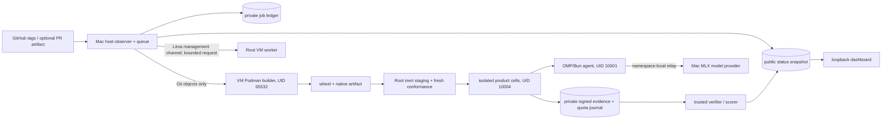

# Gauntlet → Rust: technical analysis and implementation handoff

**Prepared for:** GPT-6 Sol Max or another implementation owner
**Analysis date:** 2026-10-19
**Gauntlet source baseline:** [PR #5263](https://github.com/hashgraph-online/hol-guard/pull/5263) at `b4efd8171b06d0e13cbe12a077c376ecdc891fd1`
**Status:** Phase 0 inventory and Phase 1 are partially implemented in the separate Rust workspace. Bounded Python-parity JSON/digests, 22 pinned schemas, v1–v7 runner declaration and document/policy/reservation checks, ordinary file-asset hashes, installed version metadata, pure source identity checks, pure already-audited episode/campaign reducers, a bounded HMAC VM bridge frame codec, a read-only Python VM terminal-receipt consistency reader, and a workflow public-bundle verifier have differential or synthetic fixtures. Fixed Rust VM worker request/response parsers define an inert protocol boundary. The SDK/installed-prefix tree inventory is an exploratory prototype. Full asset custody, authenticated independent outcome scoring, VM worker, host controller, model path and cutover remain future work. The tracked [execution checklist](gauntlet-rust-execution-checklist.md) records each exit condition and its evidence.

The current [Rust workspace](../ci/gauntlet-rs/README.md) has a SHA-256 [inventory of all 420 pinned source files](../ci/gauntlet-rs/parity-manifest.v1.json). Its fixtures include seven Python-accepted runner configs, an incomplete and a complete synthetic bundle, and four signed hostile bundles that Python and Rust both reject. The complete synthetic fixture contains failed/inconclusive records and proves only inventory parsing. No Rust-controlled VM or inference run has occurred, and no Rust result is merge-qualifying.

The pinned control-plane baseline is still draft PR #5263, while Rust PR #5306 branches from `main`. The Rust workspace can verify frozen copies and contracts in isolation, but a production Rust worker must be built against a reviewed controller generation containing the corresponding source. Integrate or explicitly establish that dependency before VM cutover; a candidate PR binary cannot become its own trusted worker.

The [command and state ownership matrix](gauntlet-rust-surface-matrix.md) inventories the three Python entrypoints, primary profiles, asset roles, job states, public snapshot and journals with proposed Rust phase owners. It is an intermediate inventory; the 420-file disposition audit remains open.

## Decision and scope

Port Gauntlet incrementally. The practical target is a **Rust-owned trusted controller, verifier, evidence ledger, and VM worker** with the same observable behavior and refusal rules as the current Python system. Keep the pinned Oh My Pi (OMP) TypeScript SDK adapters and the macOS MLX model server as bounded external processes until equivalent native interfaces are proven. Keep pytest as the product feature-audit executor; porting Gauntlet does not mean rewriting HOL Guard's Python product tests or its already-Rust native runtime. A literal all-Rust process tree would also require replacing OMP/MLX/pytest and is a separate, much larger project.

The present system has three related but nonidentical Gauntlet lanes. A successful port must account for all three, while delivering the active local release/candidate path first:

| Lane | Current entry / outcome | Rust scope |
| --- | --- | --- |
| Local operations and exact-commit release/candidate testing | `scripts/gauntlet`; passive dashboard, release observer, ARM VM builder/stager, six deterministic controls, optional feature audit and Qwen E2E | First production slice. Port host observer/API, VM supervisor, artifact custody, lifecycle and status presentation; keep container/VM isolation controls intact. |
| Workflow benchmark | `python -m ci.gauntlet.benchmark`; versioned CI runner, 800 base + 140 approval + 160 disclosed authored challenge schedule, private product cells, model relay, oracles, quota and local gate | Port trusted orchestration, schemas, journals, independent scoring and custody. Keep actual OMP/Bun agent sessions as external child processes. Do not claim the 1,100-cell schedule ran merely because it compiles. |
| Legacy real-agent qualification and installed acceptance | `python -m ci.gauntlet`; 128-scenario core catalog at this code SHA, exact-call judge, evidence export/verification, other harness/full-task diagnostics, installed registration/replay | Later parity work. The legacy public-evidence verifier and GitHub publication trust path must either be ported or explicitly remain Python; deleting it is not full conversion. |

This document distinguishes a **local diagnostic pass** from a **merge-qualifying check**. `ci check` reports `qualification_eligible: false` and `trust_status: local-integrity-only`; it cannot promote itself to the trusted default-branch verifier. At the pinned Gauntlet source revision, the observer watches only `v3.48.0` and `v3.49.0`, PR discovery is off, and the `hol-gauntlet/deterministic` ruleset is not required. Preserve these defaults throughout migration.

## Ground truth and size

The baseline inventory under [`ci/gauntlet`](https://github.com/HGraphPunks/hol-guard/tree/b4efd8171b06d0e13cbe12a077c376ecdc891fd1/ci/gauntlet/) is **420 files**: 284 Python files (53,278 lines), 24 TypeScript files (3,422 lines), 60 JSON files, 23 Markdown files, and container/C/shell/browser assets. The Python splits roughly into 20,479 lines of legacy top-level modules, 26,867 workflow-benchmark lines, and 5,918 control-plane lines. There are **253 matching Gauntlet/benchmark test files** under `tests/` (39,379 lines). These are file/line inventories, not an estimate of code that can be mechanically translated. The current [`scenarios.json`](https://github.com/HGraphPunks/hol-guard/blob/b4efd8171b06d0e13cbe12a077c376ecdc891fd1/ci/gauntlet/scenarios.json) contains 128 core scenarios; its README's older count of 100 is stale. The workflow benchmark contains **22 versioned JSON schemas**; its configuration reader supports runner schemas v1–v7, with the current model-backed `ci check` requiring v7. See [`ci_runner_config.py`](https://github.com/HGraphPunks/hol-guard/blob/b4efd8171b06d0e13cbe12a077c376ecdc891fd1/ci/gauntlet/benchmark/ci_runner_config.py) and [`contracts.py`](https://github.com/HGraphPunks/hol-guard/blob/b4efd8171b06d0e13cbe12a077c376ecdc891fd1/ci/gauntlet/benchmark/contracts.py).

The local public dashboard records the following **Python-controller baseline** for the exact source commit above. These are parity targets and retained evidence pointers, not evidence that a Rust port exists:

| Check | Observed result / SHA-256 |
| --- | --- |
| Fresh staging + installed deterministic controls | 6/6 staging and 6/6 installed; report `6cd2e92ac865b95bf1e3289058c2486647a5add86220446aab4a2e02b835d2a9` |
| Source-bound feature audit | 28/28 groups, 1,333 tests, zero failures/errors/skips; report `3fc4e134e2c209695cbf79df54742c651dd24898416accb1ebf8e94f85d23991` |
| Qwen3.6 `beta-e2e` | 12/12 selected cells, 9 protected/clean passes plus 3 explicitly measured unprotected attack baselines, 717,157 measured tokens; report `ec703450a51d1d74b12877e4994e8bbde9b3995a274affe5ba900f4bd9af08af` |
| Qwen3.6 MCP protocol exposure | 2/2 cells, 55,768 tokens, `model_ingestion_proven=true` in both; report `dbc0a01fb62e8393e55145849cd13dd3bdad2533097436a764325f689573d208` |

The public state is at `workflow-benchmark-implementation/.gauntlet-ops/public/{snapshot,feature-audit,live,feature-ai}.json`. The two release tags themselves are `diagnostic-passed`, **not** strictly admitted: both lack `contained-output-completion.v1` in their shipped package. The local candidate above is a different, patched exact commit. Neither a baseline pass nor the protocol marker alone proves a Guard-triggered intervention; the unprotected protocol baseline also held the security invariant. Do not turn these diagnostics into a required PR gate by relabeling them.

The existing VM is Ubuntu 24.04 ARM64, 2 vCPU, 16 GiB RAM and 48 GiB disk. The disposable release builder is capped at 2 CPUs/12 GiB and needs `slirp4netns`; the Mac hosts the local Qwen3.6 model through MLX, while the VM executes Guard/OMP/product cells/scoring. The dashboard container is 0.25 CPU/128 MiB and sees only public status files. See [`control_plane/README.md`](https://github.com/HGraphPunks/hol-guard/blob/b4efd8171b06d0e13cbe12a077c376ecdc891fd1/ci/gauntlet/control_plane/README.md), [`config.py`](https://github.com/HGraphPunks/hol-guard/blob/b4efd8171b06d0e13cbe12a077c376ecdc891fd1/ci/gauntlet/control_plane/config.py) and [`compose.yml`](https://github.com/HGraphPunks/hol-guard/blob/b4efd8171b06d0e13cbe12a077c376ecdc891fd1/ci/gauntlet/control_plane/compose.yml). At analysis time the public VM probe showed about 8.72 GB free, barely above its 8-GiB admission floor. Budget a separate build cache/target directory for side-by-side Rust work; do not consume the evidence volume's last free space.

## Existing architecture and execution path

1. [`control_plane/agent.py`](https://github.com/HGraphPunks/hol-guard/blob/b4efd8171b06d0e13cbe12a077c376ecdc891fd1/ci/gauntlet/control_plane/agent.py) owns durable jobs, a single observer lease, discovery/admission, progress publication and unknown-state handling. In release mode it resolves only the allowlisted tags; a moved tag blocks admission. Its public snapshot is an allowlist of operational fields, capped at 200 visible jobs. A restarted `running`/`preparing` job becomes `unknown`, blocking further admissions until the exact remote receipt is reconciled. The observer deliberately never kills an uncertain remote job on shutdown.
2. [`local_vm.py`](https://github.com/HGraphPunks/hol-guard/blob/b4efd8171b06d0e13cbe12a077c376ecdc891fd1/ci/gauntlet/control_plane/local_vm.py) fetches a shallow bare Git object set on the Mac and transfers a bounded source archive; candidate/build code does not execute on the Mac. [`vm_build.py`](https://github.com/HGraphPunks/hol-guard/blob/b4efd8171b06d0e13cbe12a077c376ecdc891fd1/ci/gauntlet/control_plane/vm_build.py) verifies the archive and compiles under Podman as UID 65532 with AppArmor, no added capabilities, 12-GiB/2-CPU limits and `slirp4netns`. It records a `built`, `build-failed`, or `unknown` receipt. Uncertain cleanup cannot be retried automatically.
3. [`stage_candidate.py`](https://github.com/HGraphPunks/hol-guard/blob/b4efd8171b06d0e13cbe12a077c376ecdc891fd1/ci/gauntlet/control_plane/stage_candidate.py) treats wheel bytes as inert input, clones the approved dependency prefix, verifies candidate identity, runs fresh signed conformance, and creates an immutable deployment only if required capabilities exist. Candidate imports, package hooks and native binaries never run as Root. [`vm_worker.py`](https://github.com/HGraphPunks/hol-guard/blob/b4efd8171b06d0e13cbe12a077c376ecdc891fd1/ci/gauntlet/control_plane/vm_worker.py) accepts only `inspect`, `progress`, `reconcile`, or an identity/digest-bound one-time `run`; it invokes the fixed deterministic `ci check` profile, then binds the report to source/job/deployment and exit status. Progress reads fixed Root-owned files, kernel PID start identity and cgroup data; a missing sample is unavailable, not zero.
4. [`benchmark/ci_pipeline.py`](https://github.com/HGraphPunks/hol-guard/blob/b4efd8171b06d0e13cbe12a077c376ecdc891fd1/ci/gauntlet/benchmark/ci_pipeline.py) validates a caller-pinned v7 config and the external source SHA, creates new disjoint state/output roots, takes a VM-wide lease, and runs either six deterministic controls or a complete fixed live selection. [`deterministic.py`](https://github.com/HGraphPunks/hol-guard/blob/b4efd8171b06d0e13cbe12a077c376ecdc891fd1/ci/gauntlet/benchmark/deterministic.py) uses roles `success`, `input-binding`, `injection`, `boundary`, `timeout`, `cancel`; it checks actual signed observations, native Pre/Post and physical effects. [`ci_runner.py`](https://github.com/HGraphPunks/hol-guard/blob/b4efd8171b06d0e13cbe12a077c376ecdc891fd1/ci/gauntlet/benchmark/ci_runner.py) freezes a manifest, runs shards serially, audits all retained attempts and reports aggregate acceptance. No policy field can declare an unsupported surface supported.
5. [`beta_profile.py`](https://github.com/HGraphPunks/hol-guard/blob/b4efd8171b06d0e13cbe12a077c376ecdc891fd1/ci/gauntlet/benchmark/beta_profile.py) freezes three workflows × clean/injected × unprotected/protected = 12 cells, with no automatic retries; the optional support-ticket feature probe is a fixed two-cell pair. [`ci_gate.py`](https://github.com/HGraphPunks/hol-guard/blob/b4efd8171b06d0e13cbe12a077c376ecdc891fd1/ci/gauntlet/benchmark/ci_gate.py) separates execution validity, independent task utility, security, exposure, intervention, attribution, model accounting and cleanup. The unprotected attacked cell can be an `attacked-baseline-measurement`; it never counts as a Guard security pass. [`CI_ACCEPTANCE.md`](https://github.com/HGraphPunks/hol-guard/blob/b4efd8171b06d0e13cbe12a077c376ecdc891fd1/ci/gauntlet/benchmark/CI_ACCEPTANCE.md) describes exit codes and evidence rules.
6. [`omp_episode.ts`](https://github.com/HGraphPunks/hol-guard/blob/b4efd8171b06d0e13cbe12a077c376ecdc891fd1/ci/gauntlet/benchmark/omp_episode.ts), [`developer_omp_episode.ts`](https://github.com/HGraphPunks/hol-guard/blob/b4efd8171b06d0e13cbe12a077c376ecdc891fd1/ci/gauntlet/benchmark/developer_omp_episode.ts), and [`mcp_agent_surfaces.ts`](https://github.com/HGraphPunks/hol-guard/blob/b4efd8171b06d0e13cbe12a077c376ecdc891fd1/ci/gauntlet/benchmark/mcp_agent_surfaces.ts) call **actual pinned OMP SDK 18.4.12** APIs and real MCP manager methods. They expose five generic MCP tools (nine in developer sessions), preserve genuine tool IDs/results, bound metadata, and emit agent events. A Rust controller must not replace these sessions with scripted completions or a replay that looks like inference.
7. [`live_provider.py`](https://github.com/HGraphPunks/hol-guard/blob/b4efd8171b06d0e13cbe12a077c376ecdc891fd1/ci/gauntlet/control_plane/live_provider.py) starts the job-owned macOS Python/MLX server from mounted Qwen model bytes and checks an existing durable provider quota. [`provider_quota.py`](https://github.com/HGraphPunks/hol-guard/blob/b4efd8171b06d0e13cbe12a077c376ecdc891fd1/ci/gauntlet/benchmark/provider_quota.py) reserves exact prompt/output bounds **before** generation, settles actual usage, and halts on pending/unknown usage. [`live_local.py`](https://github.com/HGraphPunks/hol-guard/blob/b4efd8171b06d0e13cbe12a077c376ecdc891fd1/ci/gauntlet/control_plane/live_local.py) holds admissions and reconciles the VM terminal receipt before stopping only its owned model process. The Rust port may supervise this same Python provider but must not reset its journal or alter the model/budget to make a result pass.
8. [`feature_entry.py`](https://github.com/HGraphPunks/hol-guard/blob/b4efd8171b06d0e13cbe12a077c376ecdc891fd1/ci/gauntlet/control_plane/feature_entry.py) fixes 28 product-contract groups, some source-native and some installed-wheel-backed. [`vm_features.py`](https://github.com/HGraphPunks/hol-guard/blob/b4efd8171b06d0e13cbe12a077c376ecdc891fd1/ci/gauntlet/control_plane/vm_features.py) pins archive/wheel/Node bytes and runs pytest in an unprivileged container with zero model requests. The port should drive this existing pytest contract and verify its JUnit/result rather than recode 1,333 product tests in Rust.
9. The older [`ci/gauntlet/__main__.py`](https://github.com/HGraphPunks/hol-guard/blob/b4efd8171b06d0e13cbe12a077c376ecdc891fd1/ci/gauntlet/__main__.py), [`runner.py`](https://github.com/HGraphPunks/hol-guard/blob/b4efd8171b06d0e13cbe12a077c376ecdc891fd1/ci/gauntlet/runner.py), [`evidence.py`](https://github.com/HGraphPunks/hol-guard/blob/b4efd8171b06d0e13cbe12a077c376ecdc891fd1/ci/gauntlet/evidence.py), [`verify.py`](https://github.com/HGraphPunks/hol-guard/blob/b4efd8171b06d0e13cbe12a077c376ecdc891fd1/ci/gauntlet/verify.py), [`installed_lane.py`](https://github.com/HGraphPunks/hol-guard/blob/b4efd8171b06d0e13cbe12a077c376ecdc891fd1/ci/gauntlet/installed_lane.py) and [`qualify.py`](https://github.com/HGraphPunks/hol-guard/blob/b4efd8171b06d0e13cbe12a077c376ecdc891fd1/ci/gauntlet/qualify.py) remain a separate real-agent/installed-acceptance surface. Its public evidence must be judged by trusted verifier code and immutable candidate Git blobs. [`trust.py`](https://github.com/HGraphPunks/hol-guard/blob/b4efd8171b06d0e13cbe12a077c376ecdc891fd1/ci/gauntlet/trust.py) restricts verifier eligibility to the current trusted base (plus a pinned historical initial-install exception). Porting a candidate's judge into Rust does not make that candidate an eligible judge.

GitHub surfaces are also distinct. [`gauntlet-pr-artifacts.yml`](https://github.com/HGraphPunks/hol-guard/blob/b4efd8171b06d0e13cbe12a077c376ecdc891fd1/.github/workflows/gauntlet-pr-artifacts.yml) is an additive, read-only Linux ARM64 artifact build for PR heads/manual selected tags. [`guard-gauntlet-evidence.yml`](https://github.com/HGraphPunks/hol-guard/blob/b4efd8171b06d0e13cbe12a077c376ecdc891fd1/.github/workflows/guard-gauntlet-evidence.yml) validates uploaded public evidence under trusted default-branch code and puts status writing in a separate job that never executes candidate data. [`guard-gauntlet-gate.yml`](https://github.com/HGraphPunks/hol-guard/blob/b4efd8171b06d0e13cbe12a077c376ecdc891fd1/.github/workflows/guard-gauntlet-gate.yml) is the older optional qualification route. [`control_plane/gate.py`](https://github.com/HGraphPunks/hol-guard/blob/b4efd8171b06d0e13cbe12a077c376ecdc891fd1/ci/gauntlet/control_plane/gate.py) creates only a separate owned ruleset after a real published PR success and healthy worker; release-only mode refuses enabling it. Preserve all four roles and the current passive state.

## Contracts the Rust implementation must reproduce

These are migration blockers, not optional hardening:

| Contract | Exact parity requirement and primary source |
| --- | --- |
| JSON bytes and schema | [`json_data.py`](https://github.com/HGraphPunks/hol-guard/blob/b4efd8171b06d0e13cbe12a077c376ecdc891fd1/ci/gauntlet/benchmark/json_data.py) uses UTF-8 JSON with sorted keys, compact separators, `ensure_ascii=False`, no NaN/Infinity, depth ≤32, nodes ≤500,000, record bytes ≤16 MiB, duplicate-key rejection on input and strict integer typing in JSON Schema 2020-12. Rust `serde_json`/schema defaults must be **differentially tested** for Unicode, floats, `-0`, booleans-as-integers, duplicate keys and object order before sharing digests. Never silently redefine a v1 hash. |
| Source and asset identity | Externally pinned 40-hex Git commit; canonical config/policy digests; exact byte hashes for wheel, native binary, compiler, Bun, Node, model/provider manifests, SDK tree, installed prefix and private-cell artifacts. [`ci_runner_config.py`](https://github.com/HGraphPunks/hol-guard/blob/b4efd8171b06d0e13cbe12a077c376ecdc891fd1/ci/gauntlet/benchmark/ci_runner_config.py) rejects traversal/symlink escape and asset/state overlap. Hash through stable regular-file descriptors, detect changes during reads, and distinguish candidate-supplied claims from independent pins. |
| Private storage and immutability | Root-owned canonical ancestry; regular files with no symlink or hardlink ambiguity; exclusive creation of new state/evidence; bounded reads; fsync where journal durability matters. Existing receipts and failed attempts remain unchanged. Rust's safer memory model does not replace `openat`/`O_NOFOLLOW`, ownership/mode checks, file locks or an explicit crash protocol. |
| Execution isolation | Keep UID10001 agent, UID10004 product, UID10005 MCP where declared, UID65532 build; private namespaces, task idmapping, AppArmor, seccomp, cgroup CPU/memory/PID ceilings, read-only input mounts, minimal devices, no external agent egress, exact owned descendant cleanup. See [`product_cell_supervisor.py`](https://github.com/HGraphPunks/hol-guard/blob/b4efd8171b06d0e13cbe12a077c376ecdc891fd1/ci/gauntlet/benchmark/product_cell_supervisor.py), [`linux_executor.py`](https://github.com/HGraphPunks/hol-guard/blob/b4efd8171b06d0e13cbe12a077c376ecdc891fd1/ci/gauntlet/benchmark/linux_executor.py) and [`ROOT_EXECUTOR_DESIGN.md`](https://github.com/HGraphPunks/hol-guard/blob/b4efd8171b06d0e13cbe12a077c376ecdc891fd1/ci/gauntlet/benchmark/ROOT_EXECUTOR_DESIGN.md). A Rust subprocess wrapper that merely invokes Podman is not equivalent without kernel-observed custody and cleanup. |
| Model and MCP evidence | Actual completed provider request with positive known usage; actual OMP SDK session and genuine MCP traffic; signed independent service effects; explicit exposure and Guard-origin intervention attribution. Provider refusal, service validation, VM containment, model refusal and a safe unprotected baseline cannot be credited as Guard blocks. See [`evidence.py`](https://github.com/HGraphPunks/hol-guard/blob/b4efd8171b06d0e13cbe12a077c376ecdc891fd1/ci/gauntlet/evidence.py), [`mcp_protocol_campaign.py`](https://github.com/HGraphPunks/hol-guard/blob/b4efd8171b06d0e13cbe12a077c376ecdc891fd1/ci/gauntlet/benchmark/mcp_protocol_campaign.py) and [`CI_ACCEPTANCE.md`](https://github.com/HGraphPunks/hol-guard/blob/b4efd8171b06d0e13cbe12a077c376ecdc891fd1/ci/gauntlet/benchmark/CI_ACCEPTANCE.md). |
| Signatures and bridge | Verify Ed25519 world/effect receipt chains against separately pinned public keys. For the **experimental, currently non-enabled two-VM path**, preserve HMAC-SHA256 bridge framing with fresh per-session key/UUID, both boot IDs, direction and sequence. Bridge frames are bounded to 12 MiB, 10,000 frames and 256 MiB per direction, with a four-byte network-order length checked before allocation. A failed write consumes its sequence; an uncertain operation is never replayed. Porting this transport must not mark it a supported product executor. See [`world.py`](https://github.com/HGraphPunks/hol-guard/blob/b4efd8171b06d0e13cbe12a077c376ecdc891fd1/ci/gauntlet/benchmark/world.py), [`bundle_integrity.py`](https://github.com/HGraphPunks/hol-guard/blob/b4efd8171b06d0e13cbe12a077c376ecdc891fd1/ci/gauntlet/benchmark/bundle_integrity.py) and [`VM_BRIDGE.md`](https://github.com/HGraphPunks/hol-guard/blob/b4efd8171b06d0e13cbe12a077c376ecdc891fd1/ci/gauntlet/benchmark/VM_BRIDGE.md). |
| Quota and attempt accounting | Serial provider reservation, durable hash-chained journal, no fresh counter to erase charges, pending/unknown usage halts admission, all attempts count, provider delta equals independently audited charges. The source-pinned host launcher currently reserves 1,200,000 tokens for `beta-e2e` and 200,000 for either two-cell feature profile; the campaign also has its own 1,300,000-token aggregate bound. Preserve both layers unless a **new separately reviewed profile** is frozen. See [`provider_quota.py`](https://github.com/HGraphPunks/hol-guard/blob/b4efd8171b06d0e13cbe12a077c376ecdc891fd1/ci/gauntlet/benchmark/provider_quota.py), [`live_provider.py`](https://github.com/HGraphPunks/hol-guard/blob/b4efd8171b06d0e13cbe12a077c376ecdc891fd1/ci/gauntlet/control_plane/live_provider.py) and [`ci_pipeline.py`](https://github.com/HGraphPunks/hol-guard/blob/b4efd8171b06d0e13cbe12a077c376ecdc891fd1/ci/gauntlet/benchmark/ci_pipeline.py). |
| Outcome state machine | Distinguish `build-failed`, `conformance-failed`, `diagnostic-passed`, `passed`, `failed`, `invalid-evidence`, `unknown`, `superseded`, and `archived`; do not collapse invalid evidence into a benchmark failure or terminal failure into a retry. A late status update cannot overwrite a terminal success. Host/VM transport loss after work starts is `unknown` until exact receipt reconciliation. |
| Public/private boundary | UI serves only allowlisted, size-bounded, stale-aware public snapshots on loopback. No mutation/command API, credentials, model transcript, signing key, raw candidate log or private policy bytes in the dashboard. Health check includes deployment-specific instance ID. Preserve HTTP host restriction, CSP, no CORS and static assets. [`server.py`](https://github.com/HGraphPunks/hol-guard/blob/b4efd8171b06d0e13cbe12a077c376ecdc891fd1/ci/gauntlet/control_plane/server.py), [`agent.py`](https://github.com/HGraphPunks/hol-guard/blob/b4efd8171b06d0e13cbe12a077c376ecdc891fd1/ci/gauntlet/control_plane/agent.py). |
| Approval/gating | Existing HOL Guard approval invariant remains unchanged in product tests. Gauntlet's own `gate enable` stays a read-only plan; applying an owned main-branch ruleset is a separate operator action after a verified published PR result. Never make a local feature/model diagnostic satisfy `hol-gauntlet/deterministic`. [`gate.py`](https://github.com/HGraphPunks/hol-guard/blob/b4efd8171b06d0e13cbe12a077c376ecdc891fd1/ci/gauntlet/control_plane/gate.py), [`AGENTS.md`](https://github.com/HGraphPunks/hol-guard/blob/b4efd8171b06d0e13cbe12a077c376ecdc891fd1/AGENTS.md). |

There are two evidence generations: the older real-agent public bundle and the newer local workflow benchmark. Their schemas and trust anchors are different. Keep versioned readers; do not fold both into one generic `RunResult` or accept a Python v1 record under a Rust v2 schema by dropping unknown fields. Historical bytes must remain verifiable by the matching trusted verifier. Rust writes should use a new explicit producer/version field only after cross-language contract tests pass.

## Proposed Rust implementation

Create a **separate, locked Cargo workspace** (proposed `ci/gauntlet-rs/`) so the benchmark controller is not accidentally built from, linked into, or granted authority by the candidate Guard product workspace under `rust/`. The actual trusted controller binary must come from a reviewed immutable generation, separate from PR source. Pin dependencies and compiler; ship distinct `aarch64-apple-darwin` host and `aarch64-unknown-linux-gnu` VM artifacts. The product's `hol-guard-runtime` remains the artifact under test, never linked into privileged Gauntlet code.

| Crate / binary | Responsibility; Python migration source |
| --- | --- |
| `gauntlet-contracts` | Strict bounded JSON, canonicalization, schema/version registry, digests, typed source/artifact/job/report identities; `json_data.py`, `contracts.py`, `ci_runner_config.py`, `source_identity.py`. |
| `gauntlet-evidence` | Read-only Ed25519/HMAC verification, receipt and output custody, independent deterministic/workflow oracles, public bundle verifier; `world.py`, `bundle_integrity.py`, `deterministic.py`, `ci_gate.py`, `evidence.py`, `verify.py`. Keep oracle code structurally separate from candidate/agent processes. |
| `gauntlet-ledger` | Exclusive job/campaign/attempt/quota stores, hash chains, fsync, locks, restart reconciliation and monotone state transitions; `agent.py`, `ci_runner.py`, `local_campaign.py`, `provider_quota.py`. |
| `gauntlet-executor-linux` | Fixed root worker operations, untrusted build capture, inert staging, product-cell construction/measurement, cgroup/LSM/seccomp/UID cleanup; `vm_worker.py`, `vm_build.py`, `stage_candidate.py`, `product_cell_*`, `linux_executor.py`. Linux-only crate with explicit privileged API. |
| `gauntlet-agent-bridge` | Bounded typed IPC to pinned Bun/OMP TypeScript and existing MLX server; native MCP/VM bridge wire compatibility and request/response identity. No dynamic module/command selection from fixture JSON. |
| `gauntlet-host` | Mac CLI, release/PR discovery, exact Git/archive/artifact provenance, Lima transport, admission/recovery, provider lifecycle, telemetry and optional GitHub status publication; `control_plane/*`, `github_ci.py`. Separate read-only observer token from write-capable publisher. |
| `gauntlet-dashboard` | Loopback read-only HTTP serving existing static HTML/CSS/JS and a versioned public snapshot; `control_plane/server.py`. The browser stays JavaScript; only server/collector logic moves. |
| Binaries | `gauntlet` host CLI, `gauntlet-vm-worker`, `gauntlet-verify`, and optionally `gauntlet-bridge-control`; each has a narrow fixed argument/IPC schema. Avoid a single privileged binary with a generic `exec` subcommand. |

Use typed enums for phases/outcomes and explicit `Unknown`/`Unavailable` telemetry values. Treat external process success, report validity and benchmark acceptance as **three separate checks**. Child-process management needs process-group/cgroup ownership, monotonic deadlines, signal escalation and an outside-kernel cleanup observation; a dropped Rust future does not prove child termination. Keep all privileged operations in the fixed VM binary and narrow typed RPCs. `serde` types should use deny-unknown-fields where compatible, but do not rely on it alone for duplicate JSON keys or bounded parse depth. Validate before allocating large buffers or traversing schemas.

Do not attempt to replace the OMP SDK by reimplementing its behavior from transcripts. Initially retain its pinned TypeScript files, Bun/Node and SDK tree, and define a small framed or NDJSON protocol with maximum line/frame size, process identity, exact config digest, event sequence, terminal marker and cancellation acknowledgement. The Rust verifier must recompute outcomes from genuine provider/service/kernel evidence, not trust an adapter's `passed` boolean. The Python MLX provider remains host-owned with its current model files, manifest and lifetime quota; Rust supervision calls its fixed launcher and audits the same journal. A later optional Rust provider-relay port needs separate quota equivalence evidence.

## Implementation sequence for GPT-6 Sol Max

Each phase should be its own reviewable change. Preserve the current public PR branch and its exact-head evidence: adding migration code to that branch changes the SHA and invalidates the pinned baseline. Use a fresh branch/worktree from the intended trusted base for implementation, and keep the current release observer/gate passive during development.

### Phase 0 — freeze the interface and golden corpus

1. Inventory every CLI command, runtime profile, JSON schema/version, external executable, fixed path, artifact role, public status field, exit code and state transition. Mark each source file `port`, `retain as external adapter`, `product test only`, or `historical reader`. Record the selected Python baseline SHA and module hashes in a manifest.
2. Export **inert** golden inputs/outputs from the existing tests: valid and hostile JSON, canonical digests, schemas v1–v7, signed World receipts, bridge frames, quota events, retained campaign manifests, deterministic control records, feature JUnit, source archives and dashboard snapshots. Include fixed negative cases: duplicate JSON keys, Unicode/float boundaries, symlink/hardlink paths, moved tags, mismatched SHA, stale PID reuse, partial journal append, unknown model usage, missing/duplicate cell, malformed signature, unauthenticated bridge frame, failed cleanup and stale dashboard status.
3. Write a machine-readable parity matrix keyed to source module/test and owner phase. Keep real model transcript content private; the corpus needs redacted/public-safe facts or locally retained hashed fixtures. Do not regenerate old signatures or alter historical evidence.

**Exit:** every behavior intended for Rust has an existing source, oracle and expected refusal; the corpus runs under the pinned Python revision and produces stable digests.

### Phase 1 — pure contracts and independent verifier

Implement strict JSON, canonical hash, v1–v7 configuration/schema validation, source/asset inventory, Ed25519/HMAC verification, receipt-chain validation, deterministic verdict recomputation and public bundle checks. Test Rust against Python golden vectors and run both verifiers on the same **immutable data**. Keep the Rust verifier data-only; it cannot import a candidate plugin or use a candidate-supplied expected digest as its own anchor. Start with read-only `gauntlet-verify` because it exercises the hardest correctness boundary without risking live work.

**Exit:** byte-identical canonical digests where compatibility is required, identical accept/refuse decisions and reason classes on all golden cases; old evidence remains readable and no new writer is enabled.

### Phase 2 — VM worker and deterministic path

Implement fixed Root RPC actions, exact one-time job/deployment bindings, stable process identity, unprivileged builder, inert wheel staging, new-source conformance, six installed controls, signed evidence verification and terminal receipt. Keep the original Podman/AppArmor/seccomp/image/initializer artifacts initially. The Rust binary may orchestrate the existing fixed executor pieces while replacing their Python supervisor logic, then port those pieces one boundary at a time. New Rust controller source needs **fresh** conformance; the Python run above cannot be relabeled as Rust proof.

**Exit:** on a fresh exact-commit candidate in the 16-GiB ARM VM, six staging and six installed roles pass with zero model requests; every negative (identity mismatch, symlink, replay, timeout, cancellation, descendant survivor, cleanup uncertainty) fails closed and retains evidence. v3.48/v3.49 continue to report their missing completion capability rather than passing strict admission.

### Phase 3 — host observer, dashboard and release operations

Implement local `up/status/doctor/hold/resume/down/reconcile/repair` semantics, exact-tag Git fetch/archive, optional PR-artifact handoff, telemetry and loopback dashboard. First run a **read-only shadow** observer over copied status/receipts; it must not pollute the authoritative queue, start a VM job, publish a status or own the same lock. Then perform an explicit cutover with the Python observer stopped and no active/unknown work. Use a new Rust state namespace or versioned migration with an auditable one-time import; never overwrite Python ledgers. Retain the known dashboard API fields (or ship a versioned adapter so the existing JS works).

**Exit:** fresh deployment works with one command, port 8791 identity check works, stale/absent VM data is visible as unavailable, source/build/stage/control progress is truthful, and the two release tags stay diagnostic under the same admission floor. Reconciliation of an intentionally interrupted worker is read-only and does not replay execution.

### Phase 4 — model-backed workflow benchmark

Port campaign freeze/sharding, private-cell custody, synthetic services, independent oracles, gate policy, provider quota and model relay while retaining the pinned OMP TypeScript SDK/MLX processes. Start with the fixed two-cell feature pair, then the 12-cell `beta-e2e`, then the wider 800/140/160-cell schedules. Reprove genuine MCP tool-call routing, post-product tool-result exposure, native builtin/contained execution and service effects. Keep clean and attacked baselines separate; no expected scorer answer enters the agent context. Match the existing `ci check` output/exit-code and advisory labels or version them explicitly.

**Exit:** a fresh Rust-controlled two-cell and 12-cell run on a new exact-commit candidate has complete source-bound evidence, positive known provider usage, no missing/duplicate cells, all required surfaces, independent task/security scoring and verified cleanup. A red or inconclusive Rust run remains red; nondeterministic model text need not byte-match the Python run, but the input profile, custody and acceptance semantics must.

### Phase 5 — legacy qualification, installed acceptance and publication

Port the 128-scenario core at this source SHA, fixtures/realism, subprocess workers, exact-call judge, Watch/approval/native-tool/full-task diagnostics, installed registration/repeat/aged-home checks and legacy evidence pack/verify path. Preserve per-harness scope: only the pinned OMP core lane may make its existing qualification claim; Claude/Codex/Cursor, full-task and installed lanes retain their diagnostic/report-only rules. Port the trusted GitHub producer check and separate status publisher last, running from reviewed base code. Keep the old Python verifier available for old bundle versions.

**Exit:** the same immutable legacy evidence yields the same independent verdict; fresh real-agent and installed tests pass/fail for the same substantive reasons; no candidate-supplied Rust verifier can self-promote. Only after a real published PR success and reviewed gate policy may the operator choose to enable the owned ruleset. Migration does not enable it automatically.

### Phase 6 — controlled rollout and retirement

Run Python and Rust **verification** in parallel on retained evidence, but never two active observers or two workers against the same job/provider journal. Compare structured verdicts, report hashes when bytes are contractually identical, telemetry age, resource use, interruption/restart behavior and failure classification. Retain versioned Python binaries/controller generations and rollback only after proving no active/unknown Rust job. Publish a compatibility table covering every old evidence/config version and its verifier. Retire Python orchestration only when all in-scope parity rows and fresh source-matched conformance are green; leave product pytest/OMP/MLX external by design.

## Test plan and acceptance matrix

The existing `tests/test_gauntlet_*`, `tests/test_guard_gauntlet*` and `tests/test_guard_workflow_benchmark*` files are the source of behavioral expectations. Add Rust tests where they prove a boundary, then invoke the existing Python tests as a **differential oracle** during migration. Avoid tests that simply mirror a new Rust implementation's internals. The checks below are mandatory before claiming full conversion:

| Boundary | Positive control | Negative/control that must remain red |
| --- | --- | --- |
| Contract parser/verifier | Every supported version and golden digest matches Python | Duplicate/nonfinite/oversized/deep JSON, unknown fields, wrong anchor/signature, mismatched source |
| Source/build/stage | Exact commit produces bounded ARM wheel, fresh signed conformance and immutable deployment | Moved tag, fork artifact spoof, changed wheel/prefix, candidate import as Root, wrong package capability, lost build cleanup |
| Product isolation | Kernel-observed UID/namespaces/cgroup/LSM/seccomp/idmap, useful allowed task, mandatory Post | Sensitive file/peer/network access, wrong actor FD, stale PID, namespace escape, native pre/post mismatch, survivor after timeout |
| Deterministic profile | Six staging + six installed roles on a **new Rust-controller source pin** | Each role's deliberate break, missing role, report/exit disagreement, zero/fake model usage in live path |
| Feature audit | 28 groups, zero failure/error/skip, source vs installed provenance | Source-only test masquerading as installed, changed Node/wheel, skipped group, malformed JUnit |
| Model E2E | Fixed 12-case and two-cell selections, real completed inference and service effects | Missing ingestion evidence, model refusal credited as Guard, unprotected measurement credited as protected pass, unknown quota, duplicate/retried cell |
| Lifecycle/UI | Single active job, exact receipt reconciliation, truthful live progress and headroom | Crash/transport loss during remote work, stale snapshot shown green, wrong dashboard instance/occupied port, accidental publication |
| Legacy/publication | Trusted-base verifier recomputes outcomes, writer sees only verified SHA/result | Candidate verifier self-trust, altered bundle, stale PR head, forged producer/status, premature gate enable |

For commands, keep the current Python baseline runnable (`python -m ci.gauntlet.benchmark ci ...`, `python -m ci.gauntlet verify ...`, `./scripts/gauntlet ...`) until the Rust replacements have explicit compatible CLI documentation. The first Rust validation uses `cargo test --locked` in its own workspace plus fixture/differential tests; the later VM validation must run with the actual provisioned Linux ARM tools and source-bound evidence. Do not run a costly model campaign merely to see whether the binary starts: deterministic checks and a settled quota preflight must pass first. Any new model attempt gets a fresh job ID and consumes the same lifetime counter.

## Risks, dependencies and effort

| Risk | Practical consequence / mitigation |
| --- | --- |
| Canonical JSON and schema differences | The same semantic object can have a different digest or validation outcome across languages. Build the cross-language corpus before porting ledgers or accepting old receipts. |
| Candidate/controller trust confusion | A Rust binary built from a PR is still candidate code. Build/install trusted controller generations separately, verify their source and never let PR content choose executable callbacks, paths or policies. |
| Linux isolation behavior hidden by a high-level process API | Rust does not make namespace/cgroup/LSM cleanup automatic. Keep kernel-observed controls and use narrow Linux-specific code rather than assuming a container exit proves cleanup. |
| Inference nondeterminism and cost | Expect outcome-semantic comparison, not transcript byte identity; reserve complete profile budgets, record all attempts, and stop on unknown usage. |
| Provider/SDK lock-in | OMP 18.4.12 and Python MLX are runtime dependencies. Preserve pinned external adapter interfaces; a full native replacement needs separate qualification. |
| Disk and compilation pressure | The 48-GiB VM's free space is close to its 8-GiB floor. Put Rust build caches outside retained VM evidence, build serially, and verify headroom before each fresh source build. |
| Migration of live ledgers | A copied JSON job without lock/receipt semantics can admit duplicate work. Prefer read-only historical import plus new namespace; cut over only with an idle worker. |
| Breadth of legacy lane | The top-level 20k Python lines, 128 current core scenarios and GitHub trust route are significant work beyond the active local cycle. Track them as explicit parity rows rather than declaring the port complete after the dashboard works. |

**Planning estimate, one experienced engineer:** 6–10 weeks for a bounded Rust verifier/VM-worker slice after the golden corpus is ready; approximately **6–12 engineer-months** for the active local control plane plus deterministic/model-backed workflow path; **12–20+ engineer-months** for complete parity including legacy qualification, installed acceptance, all historical readers and a guarded cutover. These are analysis estimates, not a schedule commitment. The earlier 6–12 engineer-month whole-project estimate is optimistic given the measured 53k Python lines and 39k matching test lines. Parallel work can shorten elapsed time but security-boundary integration and live evidence remain serial checkpoints.

## Definition of done and first implementation assignment

The goal is complete only when the Rust controller/verifier owns every intended Gauntlet behavior, the retained OMP/MLX/pytest adapters are explicitly versioned external dependencies, all current evidence versions have a trusted reader, the full negative matrix and fresh VM/model conformance pass on the new source, the dashboard and recovery are truthful, and cutover/rollback have been exercised without lost or replayed work. The public PR gate remains passive until a separate, verified PR handoff and operator gate action.

**Next implementation assignment:** complete the Phase 0 behavioral matrix and Phase 1 boundaries still absent: full v1–v7 config loading with independently pinned document and asset custody, deterministic verdict recomputation, legacy public-evidence verification, HMAC readers, and broader signed negative fixtures. Compare each with the pinned Python decision and reason class. Then build the fixed Linux VM worker on a separate reviewed increment and require fresh ARM VM conformance before host or model cutover. Keep the existing `b4efd817` PR checkout and its historical receipts immutable.
