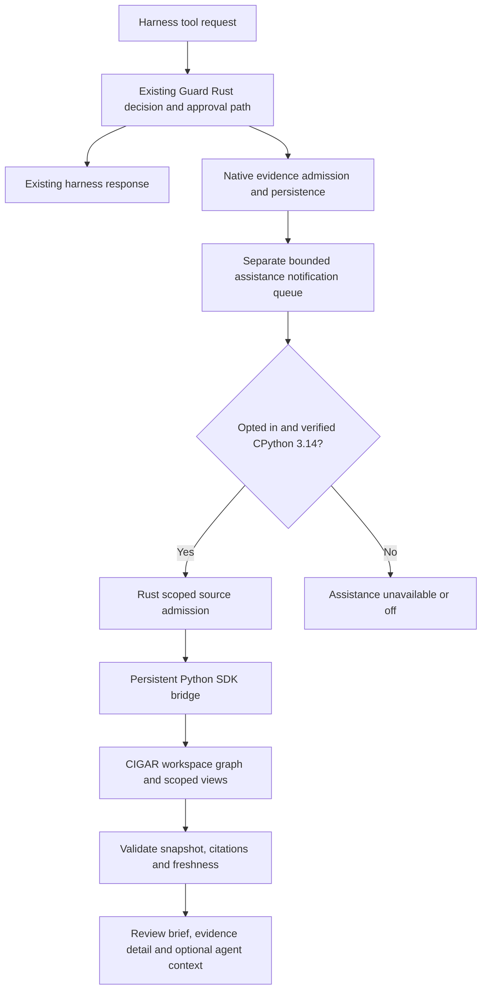

# Execution architecture for optional CIGAR assistance

The implemented integration gives Guard reusable evidence while preserving its existing authority. CIGAR's local context SDK is the entry point. The older remote Honey runtime, effect service, scheduler integrations, and full replay system are separate deployments.

Facts about the baseline are indexed in [Source evidence](source-evidence.md). The selected persistent SDK bridge and Rust-owned P0–P5 paths are implemented and [locally accepted](ACCEPTANCE.md). The original options and design sequence below remain useful context; direct Rust adoption, external providers and remote Honey deployments remain separate proposals. Current component guides and version-bound acceptance take precedence over earlier sequencing language.

## Existing execution flow

At v3.55.1, managed hooks and harness launchers enter a Python transport layer, then the Rust edge and resident. Rust owns normalization, classification, decision-critical reads, policy admission, approval validation, replay state, and the final approval consume fence. Python handles bounded transport and presentation. Production native failure produces the existing fail-safe response; it does not restore a Python semantic evaluator. See [native ownership](../native-hook-data-plane-ownership.md).

Evidence already has a background path. `HookEvidenceDispatch` orders completed-hook submissions, `NativeHookEvidenceWriter` transports them, and the resident owns the queue, journal, and store. Direct-hook evidence has its own bounded queue. CIGAR should consume admitted records after this path; it should not take over the writer or its acknowledgement mechanism.

The older `runtime/hook_enrichment_queue.py` is not a ready integration engine: its `drain_once` removes tasks without performing enrichment. Building on that placeholder would miss the active native evidence path.

Guard's [approval invariant](../approval-invariant.md) also constrains the design. CIGAR cannot add a second decision authority after an operator chooses Allow once or Always allow. Existing native action hashing, retry bindings, scope rules, and saved-approval behavior remain the governing contracts.

## Integration options

| Option | Strength | Cost or limitation | Decision |
| --- | --- | --- | --- |
| Fresh Python process and graph per hook | Small prototype | Repeated imports, worker hashing, ingestion, and startup on the critical path | Reject |
| Unconditional Python SDK dependency in Guard | Simple imports | Breaks Guard's broader Python support and loads optional code into ordinary operation | Reject |
| Python 3.14 SDK bridge with persistent graph workers | Uses the versioned public SDK, isolates Python versions, amortizes setup | Adds bridge/IPC memory and process overhead | First implementation |
| Embed `cigar-context` directly into Guard's resident | Potentially less IPC and fewer processes | Couples releases, Rust/toolchain/dependency compatibility, and resource failures to Guard authority; still needs the requested Python availability policy | Reconsider after measurement |
| Separate Rust CIGAR host using a supported native interface | Aligns with Guard's migration and isolates compute | Requires a qualified stable integration interface; directly adopting private worker wire messages would create maintenance risk | Longer-term option |
| Remote Honey/CIGAR service | Durable effects and broader runtime APIs | Introduces deployment, credentials, networking, and a separate authority model | Separate advanced integration |

The Python bridge should only call the SDK and serialize bounded results. Put deterministic policy, source handling, process supervision, and input validation in Rust. Do not relocate Python business logic into another folder to evade the native ownership gates.

## Proposed components and ownership

| Component | Owner | Responsibility |
| --- | --- | --- |
| Existing hook authority | Guard Rust resident | Original decisions, policy floors, exact action identity, approval validation and consumption |
| Assistance supervisor | New Rust module, outside the hook decision loop | Runtime eligibility, process identity, bounded job queue, deadlines, circuit state, capability generation |
| Source admission | Guard Rust and `guard-secure-fs` | Authorized reads, roots, stable file identity, redaction, source classification and revision publication |
| SDK bridge | Thin CPython 3.14 process | Public `cigar_sdk` calls and bounded IPC; no approval signing, source crawling, or shell execution |
| Context graph | Bundled CIGAR Rust worker | Indexes, relations, exact context budgets, citations, scoped views, snapshots and checks |
| Shared-agent broker | CIGAR worker, separately enabled | Authenticated grants, scoped reads, proposals, quotas, freshness and revocation |
| Review projection | Guard Rust | Validated facts, source references, currentness and bounded presentation model |
| Dashboard and Python API | Existing presentation/transport layers | Render status, settings, briefs and errors without recalculating authority |

Use one bridge per Guard installation with a bounded set of graphs, normally one per active workspace privacy domain. A graph owns a worker. Workspaces belonging to unrelated hostile principals require separate OS isolation; SDK views are logical scopes, not a sandbox.

## Proposed flow

The CIGAR path is never a prerequisite for the existing hook response. A pending review can initially show its native reason, then add an assistance panel after a bounded background result arrives. The approval request's required state must already exist independently of that panel.

Notifications carry opaque record identifiers and bounded status fields. They do not carry raw tool output, paths, prompts, or source contents through the existing privacy-safe evidence queue. Any new private source channel needs its own explicitly authorized, bounded contract.

### 1. Admit selected evidence

Start with facts Guard already owns: the current native reason, native action identity, effective policy revision, sanitized receipt facts, installed extension metadata, and source digests. A digest-only record can support a change comparison; it cannot supply missing source text or semantic meaning.

When a user explicitly adds workspace documents, Guard reads only those selections through its Rust secure I/O path. CIGAR source locators are citations, not instructions to open files. Preserve line ranges and exact revisions; normalize identifiers and reject duplicates before publication.

| Evidence class | Default | Authority treatment |
| --- | --- | --- |
| Effective native policy and action facts | Included after feature opt-in | Host-asserted facts, bound to current native revisions |
| Sanitized local receipts | Included after feature opt-in, workspace scoped | Historical observations, never a new allow grant |
| Selected workspace documentation and manifests | Off until selected | Untrusted evidence; text cannot change Guard policy |
| Agent-submitted notes or tool results | Proposal only in the sharing phase | Quarantined until host admission; preserve origin |
| Secret files, credential stores, private key material, environment files | Excluded | No automatic expansion into these sources |
| Cloud or model-provider results | Off | Separate disclosure and review contract required |

Represent explicit dependencies with `Requires` and known counterevidence with `Contradicts` only when the host can justify the relation. CIGAR preserves declared hard closures; it does not discover every real-world contradiction or infer whether a source is truthful.

### 2. Build a narrow view and compile

Derive the view from the authenticated Guard session, canonical workspace identity, selected sources, app permissions, and effective policy. Never accept the caller's proposed workspace, view, or agent identifier as authorization by itself.

Keep each view as narrow as practical. CIGAR invalidates it after any readable-scope evidence or provenance change, including an unselected document; an unrelated out-of-scope update can preserve it. An omitted root `allowed` field permits the caller-owned graph, whereas `allowed: []` permits no documents. Prefer host-created views and explicit allowlists.

Require the current action and policy facts when explaining a decision. If their complete dependency closure cannot fit the budget, return an incomplete/unavailable brief instead of quietly omitting the governing evidence. Extra document relevance must never replace the mandatory native reason.

Use the full-text mode initially. Query-window excerpts and external semantic candidates are opt-in refinements. Scope an external retrieval index before retrieval; filtering IDs afterward cannot reverse a disclosure to a provider.

### 3. Produce a trustworthy review brief

The first release can render deterministic templates from validated native facts plus attributed source excerpts. For example: an extension changed, its earlier receipt covers another digest, and a selected policy document describes the requested operation. Keep those statements distinct from a conclusion that the operation is safe.

Preserve the snapshot and citation map. A recommendation must name its basis and its uncertainty. An assistance digest associates a brief with an action; it is not added to Guard's command hash and does not become an approval token.

If free-form model prose is added later, bind the complete draft to its snapshot, derive claim review keys, obtain host-controlled independent verdicts, and use `check_answer`. A generator's own `supported` labels are not independent review. A missing/stale review withholds that prose while the native review remains usable. CIGAR validates bindings and coverage; it does not supply a semantic truth oracle.

Call `explain` on demand when a user opens selection details. It recompiles and reports successful selection steps, adding worker work. It provides neither rejected-candidate explanations nor safety scores. Do not compute it on every hook.

### 4. Help agents before another tool attempt

After the first release, add explicit read tools for action explanations and scoped context through Guard's typed MCP registry. These tools help an agent understand an already observable reason and plan a narrower request. Ordinary hooks do not establish that every harness can accept a new prompt or tool definition; qualify each installed route.

Return evidence as data, with source references and freshness. Keep capability credentials and host objects out of model inputs. A suggested command is proposed work: copying it or returning it to an agent does not execute it, and the next actual tool call follows the normal Guard path.

### 5. Share across independent processes

Use `LocalContextBroker` for explicitly enabled independent-process sharing, and for the separately controlled persistence or native execution modes that require it. Those permissions remain independent. The host retains graph ingestion, proposal admission, reviews, and policy. Each client gets narrow, expiring grants with quotas. Deliver grant material only over protected application IPC; never use a prompt, browser response, environment variable, log, or command-line argument.

Changing between graph/view mode and broker mode creates a new domain epoch, rebuilds from currently authorized sources, and invalidates old handles. Do not promise a seamless transfer of tickets or reviews. Broker graph operations are serialized; several clients share work and memory, not parallel compile lanes.

### 6. Associate context with execution

Guard's existing executor and approval flow already bind actions. Initially, record an advisory association between the exact native action identity and the retained context snapshot. Recheck CIGAR currentness when presenting a recommendation or proposing a new action. A stale recommendation is refreshed or removed; it does not revoke a supported saved Guard approval.

The candidate's `bind_execution` and `take_execution_handoff` bind a host-reviewed submission to an effect ID and intent digest. The local [native captured-Bash adapter](native-execution-context.md) now uses them with actual captured facts, a prewarmed private memory client, a bounded optional stage and native revocation/liveness checks. Four actual SDK/owning-executor tests pass, including both approval choices and failures after take. A matching installed wheel and browser flow also prove password-backed consent, actual sink execution, metadata, replay and opt-out. Actual external app delivery and the remaining platform/resource gates still need qualification. The separate `dispatch_context_effect` API targets Honey's `CigarClient` effect service and is not used as Guard's executor.

An advanced handoff check may stop an automatic *suggestion* from being dispatched with stale context. It must not insert a mandatory CIGAR veto into an approved Guard command. Consumption is not a signature, approval, durable send receipt, or lock spanning a different executor. Never claim atomic context-check-plus-tool-send unless a separately proven executor protocol provides it.

## Reuse and invalidation

Reuse graphs and unchanged sources to amortize ingestion, worker startup, complete worker hashing, and exact tokenization. Coalesce duplicate assistance jobs for the same action and scope. Debounce source refreshes and use source replacement instead of rebuilding a graph.

Key a cached assistance result by at least workspace domain and epoch, session/view generation, native action identity, native policy/catalog revisions, readable-source revisions and provenance, disclosure settings, request/budget, and package/worker identity. Revalidate at use. A cache never stores a reusable permission to execute.

File watchers are hints, not proof that evidence is current. Guard's stable read and revision admission remain authoritative. Reconcile missed events and delete/withdraw stale sources. Keep source revision strings as strings; converting them to JavaScript numbers can lose exactness.

Snapshot deltas can reduce storage or transport when the receiver has the exact base. They do not reduce the full context required by a stateless model. The SDK's `o200k_base` accounting applies to rendered context, so reserve separately for history, system messages, provider framing and output, and qualify other model tokenizers.

## Failure behavior

| Condition | Assistance behavior | Guard execution behavior |
| --- | --- | --- |
| Off, unsupported Python, or prohibited by managed policy | No worker, context tools, ingestion or compile | Existing Guard behavior |
| Bridge unavailable or integrity/capability check fails | Stop assistance and show a bounded reason | Existing Guard behavior; no semantic fallback |
| Stale source, revoked view, expired grant | Remove/refresh that brief; require a new context check | Existing approval semantics |
| `LimitExceeded` | Narrow source/candidate scope or report the limit | Existing Guard behavior; do not retry the same expensive compile |
| Assistance queue overflow | Coalesce/drop optional jobs and count gaps | Preserve required native evidence and approval state |
| Unknown mutation outcome | Reconcile source/proposal state; do not retry blindly | Do not duplicate tool dispatch |
| Unknown tool execution outcome | Show existing execution uncertainty | Existing executor reconciliation; never infer failure from a missing post event |
| Recovery from persisted CIGAR evidence | Fresh epoch, new scopes/grants, recompile and review | Guard approvals remain managed by Guard |

Retain the native evidence queue's acknowledgement and failure semantics. An optional assistance consumer must not drain records away from their authoritative writer or back-pressure the writer behind a CIGAR compile.
