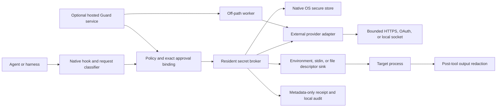

# Secret Management and Secret Reads PRD

Status: proposed. This document describes a product and implementation plan. It does not claim that
the provider contract, CLI, dashboard, or cloud service already exists.

Companion documents are the [TODO](secret-management-todo.md), [takeaway prompt](secret-management-takeaway-prompt.md),
[threat model](secret-management-threat-model.md), [provider matrix](secret-management-provider-matrix.md),
[contract proposal](secret-management-provider-contract.md), [contribution guide](secret-management-provider-contributing.md),
and [research report](secret-management-research.md).

## 1. Objective

Give an agent a safe way to use a credential without asking the agent to read a plaintext environment
variable, credential file, command argument, or conversation message.

Guard becomes the local control point for secret references, secure storage, provider reads, materialization
into a bounded process, rotation signals, and auditable policy. Guard does not become a general-purpose vault,
does not execute provider-supplied code, and does not decide which credentials a provider may issue.

The product has four outcomes.

1. A first-party native backend stores small user-managed secrets in the operating system's secure store.
2. A reviewed provider contract lets external secret managers integrate through data and a bounded adapter,
   while remaining external and opt-in until a local administrator enables them.
3. Agent workflows use opaque references and guarded delivery sinks, so secret values stay in the resident
   process whenever possible.
4. A later hosted service can offer fleet policy, provider catalogs, lease coordination, audit, and sponsored
   integrations without receiving secret values by default.

## 2. Problem and user stories

Today Guard can identify many direct environment, file, MCP, and prompt reads as sensitive. The native
environment detector and the MCP sensitive-read evaluator keep those reads reviewable, but they do not give a
developer a provider-neutral way to supply a secret to a process without exposing it to an agent or writing it
to a file. The current encrypted file store and platform secure-storage functions also serve internal Guard
state rather than a user-facing secret-reference API. The observed baseline is in
`rust/crates/guard-command/src/environment_secret_dump.rs`, `rust/crates/guard-runtime/src/mcp_sensitive_read.rs`,
`rust/crates/guard-runtime/src/encrypted_secret_store.rs`, `rust/crates/guard-runtime/src/secrets_cli.rs`, and
`rust/crates/guard-runtime/src/approval_enrollment_platform.rs`.

### 2.1 Local developer

The developer stores a token once in the native backend, writes a reference such as
`guard-secret://native/project-api/token`, and asks an agent to run a test command with the token injected into
one named environment variable. The approval card shows the provider, reference label, destination process,
workspace, and expiry. It never shows the value.

### 2.2 Team using a provider

The team connects a provider such as Vault, AWS Secret Manager, Google Secret Manager, or an Azure vault service,
1Password Connect, Bitwarden Secrets Manager, Doppler, or Infisical. The provider credential is entered through
a write-only connect flow and stored in the operating system secure store. The agent uses the same reference and
delivery API regardless of provider.

### 2.3 Dynamic credential workflow

The agent requests a short-lived dynamic credential from a provider that supports leases. Guard returns the
credential only to the selected delivery sink, records a lease digest and expiry, and renews or revokes it only
through an explicit future capability. A provider outage leaves the existing Guard decision intact and adds a
bounded unavailable state.

### 2.4 Security administrator

The administrator enables or disables a provider, limits reference prefixes, chooses allowed delivery sinks,
requires fresh provider state for selected classes, and receives metadata-only audit events. A cloud policy can
strengthen local policy but cannot enable an external provider without local authorization.

### 2.5 Provider or sponsor

The provider contributes a manifest, fixtures, a public privacy statement, and a conformance report. It can earn
discovery placement, verified-publisher status, a sponsored integration label, or a hosted-service package. It
cannot change Guard's default floors, grant itself allow authority, or receive secret values through telemetry.

## 3. Scope

### 3.1 Version 1 scope

- Native secure storage on macOS Keychain, Linux Secret Service, and Windows Credential Manager.
- A provider-neutral, canonical secret reference with version selectors and field selectors.
- Native metadata reads and resident-only materialization into environment, stdin, or a file-descriptor sink.
- Pre-tool and process-launch checks for references, existing direct secret-read classification, and post-tool
  output redaction for known values.
- A declarative provider manifest for bounded HTTPS JSON reads with exact hosts, explicit authentication, bounded
  response mapping, and no redirects.
- A closed adapter escape hatch for providers that need OAuth, dynamic leases, signed requests, or a local socket.
- External provider contributions that are off until locally enabled.
- CLI, loopback daemon, dashboard, receipt, and test contracts that keep secret material resident-only.
- A fixture provider and cross-platform conformance suite.

### 3.2 Later scope

- Brokered browser or device sign-in built on the existing brokered sign-in transport.
- Workload identity and SPIFFE-aware adapters for headless and containerized execution.
- Lease renewal and revocation orchestration.
- A hosted Guard service for fleet policy, provider connection management, audit export, and sponsored catalogs.
- Push events for provider rotation, expiry, and revocation.
- Provider write, delete, rotate, and secret-generation capabilities.

### 3.3 Non-goals

- Replacing Vault, a cloud secret manager, a password manager, or a hardware security module.
- Returning a secret value to an agent, dashboard, Python layer, receipt, log, telemetry record, or public API by
  default.
- Loading provider code, scripts, WASM, regular-expression callbacks, or downloaded detectors from a manifest.
- Calling a provider on the hook hot path unless a protected setting explicitly requires a fresh result.
- Treating a provider's label, sponsorship, payment, or verified status as authorization.
- Automatically importing all environment variables, credential files, shell history, or local config files.
- Writing resolved secret values to the workspace, a normal temporary file, a command argument, or a URL.
- Granting a provider permission to approve, block, or lower Guard policy on its own.

## 4. Existing Guard baseline

| Area | Existing owner | Reuse or change |
| --- | --- | --- |
| Direct environment secret classification | `rust/crates/guard-command/src/environment_secret_dump.rs` | Keep as the floor for raw environment reads. Add reference-aware facts beside it. |
| MCP sensitive-file reads | `rust/crates/guard-runtime/src/mcp_sensitive_read.rs` and `rust/crates/guard-contracts/src/mcp_sensitive_read.rs` | Keep exact-context approval and saved-decision composition. Add a separate materialization contract. |
| Internal encrypted file store | `rust/crates/guard-runtime/src/encrypted_secret_store.rs` | Keep for Guard state. Do not silently make it the default user vault. |
| Platform secure storage | `rust/crates/guard-runtime/src/approval_enrollment_platform.rs` and platform dispatch modules | Extract a resident-only backend interface and use a different service or target scope for user secrets. |
| Secret scanning CLI | `rust/crates/guard-runtime/src/secrets_cli.rs` | Reuse detection and redaction helpers for output and fixture checks. |
| Approval invariant | `docs/guard/approval-invariant.md` | Every secret materialization review keeps Allow once and Always allow. |
| Command extension authoring | `docs/guard/extensions/contributing.md` and `docs/guard/extension-contributions.md` | Add a sibling secret-provider contribution type. Preserve external opt-in and generated artifacts. |
| MCP contribution trust | `docs/guard/mcp-server-contributions.md` | Reuse external trust, local-admin activation, and tightening-only defaults. |
| Provider integration precedent | `rust/crates/guard-yanez-pulse/` and `docs/guard/yanez-pulse-approval-gate.md` | Reuse zeroizing credentials, pinned HTTPS, strict JSON, capped bodies, and no redirects. Preserve Pulse behavior. |
| Browser provider substrate | `docs/guard/browser-protection-prd.md` | Share transport, provider identity, discovery, secret custody, and conformance ideas when that work lands. Keep secret reads as a distinct capability family. |

## 5. Product invariants

These invariants apply to every backend, provider, hook, CLI route, and cloud integration.

### I1 Approval invariant

Every review or reapproval offers Allow once and Always allow. An approved retry runs only for the exact bound
request. A durable allow never bypasses a stronger block or sandbox floor. The full invariant remains in
`docs/guard/approval-invariant.md`.

### I2 Resident custody

Secret material exists in plaintext only in the resident or in the target delivery process. The value is wrapped
in a zeroizing type where the language and API permit it. Secret-bearing structures do not implement public
`Debug`, do not serialize outward, and do not enter Python, the dashboard, the agent conversation, a receipt,
telemetry, or a URL.

### I3 Evidence is not authority

Provider manifests, provider response fields, sponsorship, publisher metadata, and provider health contribute
facts. Only Guard policy, a local administrator, or a managed policy with the required proof can authorize a
read, delivery mode, grant, or provider enablement.

### I4 Least disclosure

The request sent to a provider contains only the canonical provider identifier, the bounded provider-local
reference, the declared version or field selector, and the minimum authentication material. It does not contain
agent prompt text, command text, local paths, repository names, environment values, workspace contents, or
unrelated references.

### I5 Native ownership

Rust owns reference parsing, provider request construction, authentication handling, secret storage, materialization,
lease state, redaction, and policy decisions. Python remains a thin argument and rendering layer that calls the
native runtime.

### I6 External opt-in

An external provider or hook is inert until a local administrator enables it. A signed cloud response cannot turn
one on. Turning it off returns it to inert and removes its cached material and provider session where the provider
contract permits.

### I7 No provider authority

A provider can add a finding, require a fresh read when the user or administrator enabled that behavior, or make a
read unavailable. It cannot lower a Guard floor, create an approval, widen a grant, or authorize a different
reference.

### I8 No network on the hot path

The normal hook and relay paths consult local metadata, policy, cached provider state, and the native store. A
provider network request runs in an off-path worker. A protected setting may require a fresh read for a selected
capability, in which case the request remains a review until the bounded read completes.

### I9 Fail direction

An unavailable, stale, malformed, rate-limited, or unauthorized provider never becomes an allow. The result is
the no-provider Guard decision plus a bounded provider state. A policy that requires fresh state turns the result
into review or block according to local policy.

### I10 Binding and replay

Every materialization binds the provider connection identity, canonical reference digest, version selector,
resolved provider version when known, capability, delivery sink, destination identity, workspace, harness,
purpose, policy digest, and extension-control digest. A changed reference, destination, provider connection,
provider version, or policy produces a new request.

### I11 Delivery containment

Version 1 permits environment, stdin, and an inherited file descriptor. Files are disabled by default and use a
Guard-owned private temporary path only when an explicit policy enables them. Direct agent-text, command-argument,
URL, clipboard, and ordinary workspace-file delivery are blocked by default.

### I12 Public hygiene

Fixtures, tests, commits, pull requests, and public docs use synthetic names and hosts. No provider token, local
path, private infrastructure detail, or raw provider payload enters a public artifact.

### I13 Payment independence

Sponsorship can affect discovery placement and a disclosure label. It cannot affect a policy floor, provider
verification result, provider ordering in a decision, or a secret read outcome.

## 6. Terminology

| Term | Meaning |
| --- | --- |
| Secret | A value whose disclosure can authenticate, authorize, identify, decrypt, or impersonate. |
| Secret reference | A canonical opaque locator that names a provider and a provider-local record without carrying the value. |
| Backend | A local or remote implementation that stores or resolves a reference. |
| Provider | An external service or product that exposes a backend through a reviewed manifest or adapter. |
| Materialization | Resolving a reference into bytes for one bounded delivery sink. |
| Delivery sink | The resident-approved destination, such as an environment variable, stdin, or file descriptor. |
| Lease | A provider-issued validity interval and identifier for a dynamic credential. |
| Secret fingerprint | An HMAC digest used for short-lived output redaction and never used to recover the value. |
| Hook | A Guard-owned lifecycle point that observes or composes a secret request. A hook declaration never loads arbitrary code. |

## 7. User-facing flow

### 7.1 Native setup

The user runs `hol-guard secrets set native/project-api/token` or uses the Protection Center. The value is
collected from a hidden input or standard input, validated against a bounded size, and written to the OS secure
store. The output reports only the reference and backend state.

The native backend uses a dedicated service or target scope. It must not reuse the internal approval-enrollment
account scope. macOS uses a generic-password item with a stable service and account pair. Linux uses Secret
Service lookup attributes. Windows uses a generic Credential Manager target with bounded credential data. The
repository already has platform-specific secure-state plumbing that can be factored without changing its current
approval behavior. Apple describes generic password items and access controls in the Keychain Services docs,
Linux Secret Service describes item attributes and user-unlock prompts, and Microsoft documents CredRead and
CredWrite for the per-user credential set. [Apple Keychain Services](https://developer.apple.com/documentation/security/keychain-services),
[Secret Service API](https://specifications.freedesktop.org/secret-service/latest-single/),
[CredRead](https://learn.microsoft.com/en-us/windows/win32/api/wincred/nf-wincred-credreada)

### 7.2 Reference setup

The user writes a reference in a project-owned configuration file or asks the agent to use one. A reference has
the form shown below.

```text
guard-secret://<provider>/<scope>/<name>[#<field>][?version=<selector>]
```

The parser normalizes percent encoding, rejects empty or dot segments, rejects control characters, enforces a
maximum length, and never treats the reference as a URL to fetch. `provider`, `scope`, `name`, `field`, and
`version` are data for the selected provider contract. The adapter turns them into a provider request after policy
checks.

### 7.3 Guarded execution

The preferred command form is conceptually equivalent to the following. The final CLI spelling is a contract
decision in the implementation phase.

```text
hol-guard secrets exec \
  --env API_TOKEN=guard-secret://native/project-api/token \
  -- npm test
```

The resident resolves the reference, asks for review when required, injects the value into the child process, and
tracks the process and lease. The agent receives only the command result and a metadata-only receipt. A provider
secret never appears in the command argument vector.

### 7.4 Direct read

`secret.metadata` can return a reference label, provider state, version metadata, expiry, and allowed delivery
modes. `secret.value` is a sensitive operation. The default policy blocks direct value return to an agent. A local
administrator can change the policy to review, which then offers both required approval choices and a warning that
the agent will receive the value.

### 7.5 Rotation and failure

A provider may report that a version changed, a lease expired, or a connection is unauthorized. Guard marks the
local state and prevents reuse of the stale material. It does not silently fall back to an older value unless the
user or administrator selected an explicit version and the provider confirms it is still valid.

## 8. Architecture



### 8.1 Components

| Component | Responsibility |
| --- | --- |
| `SecretRefV1` | Parse, normalize, and digest references. It never resolves a value. |
| `SecretProviderManifestV1` | Declare provider identity, auth, fixed or user-configured hosts, capabilities, request bounds, and response mappings. |
| `SecretProviderCompiler` | Validate manifests, produce deterministic descriptors, enforce closed operations, and generate trust metadata. |
| `SecretStore` | Read and write the native backend, with a separate scope from Guard internal state. |
| `ProviderConnection` | Store non-secret connection metadata and an opaque credential handle. The credential itself stays in the native store. |
| `SecretBroker` | Resolve a reference, apply policy, call the adapter, and return a resident-only materialization. |
| `DeliveryPlan` | Describe the sink, destination identity, lifetime, and cleanup behavior. |
| `LeaseManager` | Track provider lease identifiers, expiry, renewability, and revocation state without persisting values. |
| `OutputRedactor` | Scan bounded post-tool output and replace known values with a fixed marker or fail closed. |
| `Hook adapters` | Project agent and MCP requests into `SecretRequestV1`. They do not resolve values. |
| `Cloud bridge` | Later sync signed policy, provider catalog, and metadata-only audit. It never becomes the local value store by default. |

### 8.2 Suggested repository layout

The exact names can change during implementation, but ownership should remain clear.

```text
contracts/secret-providers/secret-provider.v1.schema.json
contracts/secret-providers/secret-reference.v1.schema.json
contributions/secret-providers/provider.<slug>.json
contracts/extensions/trust/provider.<slug>.v1.json
rust/crates/guard-secret-provider/
rust/crates/guard-runtime/src/secret_broker.rs
rust/crates/guard-runtime/src/secret_store_platform.rs
rust/crates/guard-runtime/src/secret_reference.rs
rust/crates/guard-runtime/src/secret_delivery.rs
rust/crates/guard-runtime/src/secret_lease.rs
rust/crates/guard-runtime/src/secret_redaction.rs
rust/crates/guard-contracts/src/secret_provider.rs
rust/crates/guard-contracts/src/secret_request.rs
rust/crates/guard-contracts/src/secret_delivery.rs
tests/fixtures/secret-provider-<slug>.v1.json
docs/guard/secret-management-provider-contributing.md
```

### 8.3 Runtime boundary

The broker lives in the resident and uses the existing managed egress policy for provider calls. Provider
requests are HTTPS only, use exact host allowlists or an explicit user-configured endpoint, follow no redirects,
cap request and response bytes, cap time, parse strict JSON, and reject unsupported content types. Credentials are
never placed in query strings. A redirect, host change, malformed response, or oversized response produces a
bounded error and no materialization.

The decision path reads a local connection row and a cache. A worker performs network reads and stores only
metadata, version identifiers, lease state, and a zeroizing in-memory value long enough to deliver it. The worker
uses a token bucket, negative caching, a circuit breaker, and jittered refresh. A provider call never waits on an
agent hook unless a protected fresh-state setting is active.

### 8.4 Data classes

| Data | Local resident | Target process | Agent or dashboard | Hosted service by default |
| --- | --- | --- | --- | --- |
| Secret value | Yes, zeroizing and bounded | Yes, only in selected sink | No | No |
| Provider credential | Native secure store and zeroizing memory | No | No | No |
| Canonical reference | Digest and redacted label | Optional environment name only | Label and digest | Digest only with opt-in |
| Version and expiry | Yes | Optional non-secret metadata | Yes | Metadata with opt-in |
| Request and policy digest | Yes | No | Receipt label | Optional metadata |
| Raw command, prompt, path, environment value | No persistent copy | Process may use its own inputs | No | No |

## 9. Secret provider contract

The full proposed contract is in [secret-management-provider-contract.md](secret-management-provider-contract.md).
The contract is intentionally smaller than a general plugin runtime.

### 9.1 Provider identity and trust

Each provider has a stable `provider.<slug>` id, publisher metadata, public documentation, privacy and terms
links, a versioned manifest, a trust binding, and a fixture corpus. A source file cannot choose `first-party`,
`trusted-library`, or `verified`. Contributions start as `external` and `opt-in`.

### 9.2 Closed capability set

Version 1 supports these capabilities.

| Capability | Result | Default policy |
| --- | --- | --- |
| `secret.metadata` | Label, state, versions, expiry, and allowed sinks | Allow when local metadata is available |
| `secret.resolve` | Materialization into a resident-approved sink | Require review or reapproval |
| `secret.lease` | Dynamic value plus lease metadata | Require review and short expiry |
| `secret.verify` | Validate connection without returning a value | Review on connect, then metadata-only |

`secret.write`, `secret.delete`, `secret.rotate`, `secret.renew`, and `secret.revoke` remain future capabilities.
Adding one is a contract change with a new threat review and fixture family.

### 9.3 Authentication modes

- `native_keychain` for the first-party backend.
- `api_token` for providers that require a user-supplied key. The key is entered through a write-only flow and
  stored in the native secure store.
- `oauth_device` or `oauth_loopback` for user sign-in. Tokens and refresh tokens stay in the native secure store.
- `oidc_workload` for a short-lived workload assertion supplied by a supported host.
- `spiffe_workload` for a local Workload API or equivalent adapter.
- `local_peer` for a provider daemon whose local socket can prove peer identity.

The manifest cannot ask Guard to read an arbitrary environment variable or file as its bootstrap credential.
Import flows are explicit, reviewed, and one-time.

### 9.4 Reference and delivery binding

The exact-action materialization digest covers the canonical reference, provider connection id and identity hash,
capability, version selector, resolved version when known, delivery kind, destination name or digest, process
identity, workspace identity, harness session, purpose, policy digest, and extension-control digest. The secret
value is never part of the digest material.

The default durable scope is one exact reference and one delivery shape. A provider-wide or scope-wide grant is
out of scope for version 1 because it creates a broad confused-deputy boundary.

## 10. Hooks and integration points

Hooks are Guard-owned lifecycle events with typed inputs. A provider contribution can subscribe to a closed event
kind but cannot load a callback.

| Hook | Input | Allowed provider effect |
| --- | --- | --- |
| `pre_tool.secret_request` | Provider id, reference digest, capability, destination class, workspace digest | Add metadata or require fresh state when policy already permits it |
| `pre_exec.secret_delivery` | Destination process identity, sink kind, reference digest, lease request | Allow or require review under Guard policy |
| `post_tool.output` | Bounded output bytes after local redaction, no provider call by default | Redact known values or record a local finding |
| `lease.expiring` | Lease digest, expiry, provider id | Schedule a bounded refresh or show a notice |
| `provider.revoked` | Provider connection id and reason code | Mark connection invalid and stop new materialization |
| `cloud.policy.updated` | Signed policy digest and generation | Apply only after local authority checks |

The initial implementation only needs `pre_tool.secret_request`, `pre_exec.secret_delivery`, and
`post_tool.output`. Lease and cloud hooks can land as metadata-only events first.

## 11. Cloud and sponsorship model

### 11.1 Cloud products

The local product should ship first. The hosted service can then add distinct paid capabilities.

| Product surface | Customer value | Data boundary |
| --- | --- | --- |
| Provider catalog | Discover reviewed adapters and connection instructions | Public metadata and signed manifests |
| Fleet policy | Require providers, references, delivery sinks, or fresh state across devices | Signed policy and digests, no values |
| Audit export | Search approval, lease, rotation, and failure events | Metadata-only records selected by the tenant |
| Lease coordination | Coordinate short-lived credentials and revocation notices | Lease ids, expiry, and digests unless a tenant explicitly chooses envelope mode |
| Guard Secret Broker | Hosted policy and ephemeral exchange for teams that do not want local provider clients | Secret values remain provider-to-device when possible. Any brokered value path needs a separate encryption and compliance review |
| Conformance and verified publisher | Public trust signal and compatibility report | Manifest, fixtures, evidence digest, and publisher identity |

### 11.2 Sponsor surfaces

- Sponsored provider placement in the existing discovery feed with an explicit sponsor label.
- Provider-specific setup links and referral attribution that contain no device or account identifier.
- Verified provider and conformance badges that are earned through review, not payment.
- Co-funded native adapters, cross-platform test coverage, and release qualification.
- Enterprise policy packs, audit exports, and managed connector operations.
- Hosted Secret Broker plans with tenant-owned encryption material and region controls after the local product proves its data boundary.

Payment never appears in a runtime decision input. A paid listing cannot outrank a security finding or change a
provider effect level.

## 12. Provider rollout strategy

The [provider matrix](secret-management-provider-matrix.md) contains the research-backed comparison. The suggested
sequence is:

1. Native OS backend and fixture provider.
2. HashiCorp Vault KV v2 and dynamic-lease adapter.
3. One cloud provider with short-lived workload identity, starting with AWS Secrets Manager or Google Secret
   Manager according to the first sponsor design partner.
4. A second cloud provider to prove the contract is provider-neutral.
5. 1Password Connect or Bitwarden Secrets Manager to cover team password-manager workflows.
6. Doppler and Infisical through the same contract, with machine identity and scoped service-token tests.

No provider should be listed as a built-in authority merely because it is popular. Each adapter must pass the same
manifest, privacy, fixture, output-redaction, outage, and installed-runtime checks.

## 13. Success measures

| Measure | Initial target |
| --- | --- |
| Secret values in agent-visible output for guarded delivery cases | 0 |
| Secret values in receipts, logs, telemetry, and dashboard responses | 0 |
| Raw direct environment or credential-file reads that bypass the existing floor | 0 |
| External provider contribution that is active before local-admin enablement | 0 |
| Provider network calls on the ordinary hook path | 0 |
| Materialization requests missing Allow once or Always allow when review is required | 0 |
| Materialization requests with an unbound destination or changed reference that reuse an allow | 0 |
| Provider outage that lowers the no-provider Guard decision | 0 |
| Cross-platform native backend pass rate | 100 percent for supported OS lanes |
| Secret delivery overhead for a cached native value | p95 under 25 ms on a release build |
| Provider request response and memory bounds | Every limit enforced before allocation |
| Provider-caused prompt increase for metadata-only or unavailable cases | 0 |

## 14. Test and qualification plan

Every implementation pull request adds the smallest proof that fails on the parent revision and passes on the
change.

- Contract tests reject unknown fields, arbitrary URLs, query credentials, wildcard hosts, oversized limits,
  undeclared response pointers, and unsupported delivery modes.
- Native unit tests cover normalization, reference ambiguity, version binding, lease expiry, zeroization wrappers,
  platform-store errors, and output redaction.
- Fixture tests cover native, provider, safe metadata, allowed delivery, denied direct value, provider outage,
  stale version, changed destination, changed policy, malformed response, redirect, and oversized response.
- Property tests assert that provider results never produce a lower Guard action and that a changed reference,
  provider identity, destination, or version cannot reuse an old allow.
- Cross-platform tests use real OS secure stores in supported runners and a deterministic unavailable backend for
  unsupported environments. The unsupported path must not claim native storage.
- Harness tests cover Claude Code, Codex, Cursor, and other supported hook payloads through the existing native
  replay paths. A direct secret value never appears in the captured payload.
- Installed Guard tests run `hol-guard --version`, one destructive or sensitive `command explain` case, one safe
  counterpart, the provider conformance command, and a disposable guarded delivery flow after a released build
  contains the feature.
- Optional Gauntlet evidence is additive. It records the exact candidate and installed runtime, and it never
  substitutes for deterministic tests or approval-invariant coverage.

## 15. Open decisions

1. Final CLI names and whether `secrets exec` is implemented in the existing package shim or the resident command.
2. Whether v1 supports file-descriptor delivery on every platform or begins with environment and stdin only.
3. Whether self-hosted provider endpoints allow private-network hosts by explicit user proof or require a local
   adapter process.
4. Which cloud provider is the first sponsor design partner. The contract must remain provider-neutral.
5. Whether direct agent value reads are always block or can be changed to review by a protected local setting.
6. Whether lease renewal belongs in the first provider adapter or ships as metadata-only expiry notices first.
7. Which hosted audit fields a tenant may export while preserving the no-value default.

Each decision belongs in an ADR before the dependent implementation lands.

## 16. Research basis

The companion research report records the source URLs and the reasoning that turns them into Guard-specific
constraints. The most important external findings are that OS stores provide different access and prompting models,
major cloud services expose versioning, scoped IAM, audit, and rotation controls, Vault exposes renewable leases and
HMAC-protected audit values, workload identity avoids long-lived bootstrap keys, and existing provider ecosystems
already standardize machine accounts, service tokens, and secret references.
